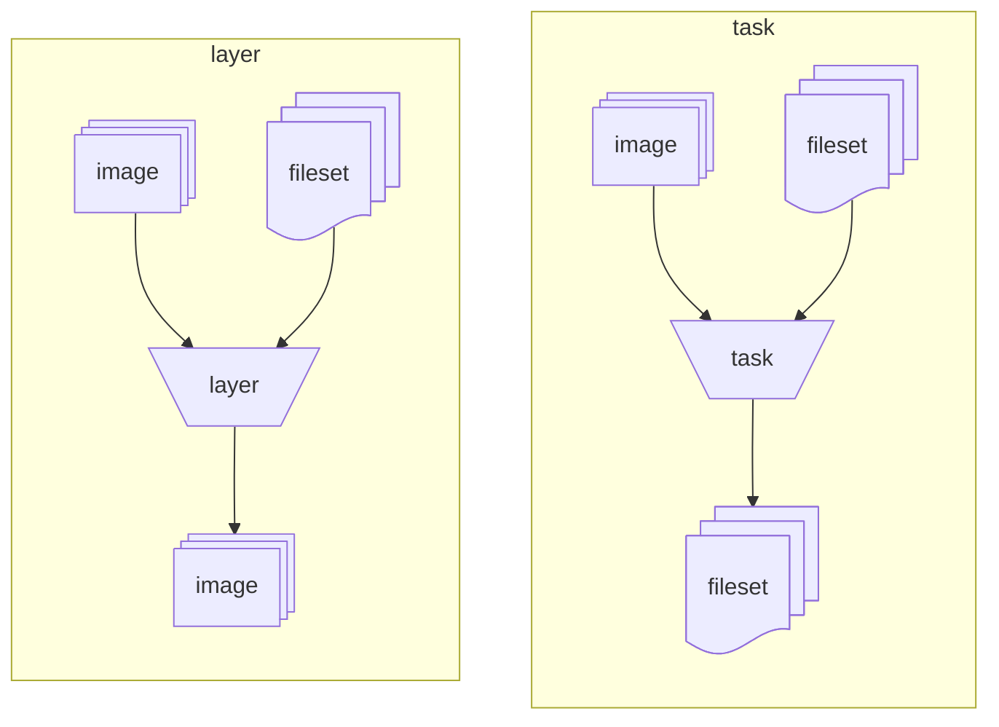
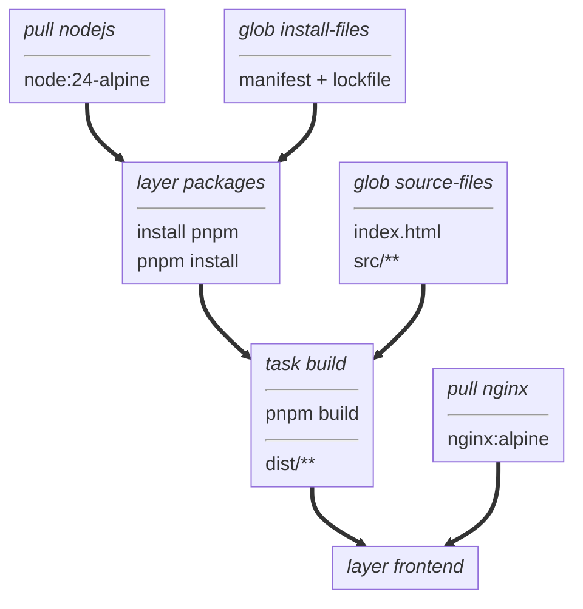

# Tutorial: from source files to a running container

This tutorial walks through [examples/typescript-ui](../examples/typescript-ui/),
a small TypeScript website built with Node.js and served by nginx.
You will learn the artifact model, set up vamos, and read the example's `BUILD` file one target at a time.
All the project files are included in the repository.
The finished image contains the built website and nginx; Node.js and the build dependencies stay in the build cache.
You need a checkout of this repository, Docker, and network access to fetch images and packages.
Node.js and pnpm run inside build containers, so you do not need to install them on your host.

## 1. Understand what a build produces

vamos operations manipulate two kinds of artifacts:

- An **image** is the container image you already know from Docker or Podman.
  An image can provide build tools or run the finished application.
- A **fileset** contains files at relative paths, including their modes and symbolic links.
  Think of it as the contents of a tarball.
  Adding a fileset containing `assets/main.js` to `/app` creates `/app/assets/main.js`.

Two operations turn these artifacts into new results:

- A **layer** starts from a base image, adds filesets, runs commands, and keeps the new image.
  It retains its base's files and configuration, plus its own changes.
- A **task** starts from a base image, adds filesets, runs commands,
  and collects selected files into a new fileset.
  Its temporary container is discarded after collection, so only the selected files pass to the next target.



Both operations can add input filesets and run commands in their base image.
For this website, a layer will install dependencies into a Node.js image.
A task will use that image to build the website and keep only the generated files.
A final layer will add those files to an nginx image.
That is how the build tools stay out of the application image.

The two operations that bring inputs into a build are **pull**, which fetches an image from a registry,
and **glob**, which selects local files into a fileset.
A `BUILD` file declares these operations as named **targets** in Starlark, a Python-like language.
In a directory that also holds a `build` directory, name it `BUILD.vms`,
since `BUILD` and `build` are one name where case is ignored, as on macOS;
see [workspaces](reference/configuration.md#workspaces).
Targets refer to one another by name: `base` selects an image, and `add()` copies in a fileset.
Declare local targets before the targets that use them.
A task's result is a fileset, so a task cannot be another target's base image.

## 2. Set up vamos

vamos uses Buildah and needs Linux container privileges.
Choose one of the first two setups, then use the same `vamos` command throughout the tutorial.
The third installs vamos in your own project's devcontainer.

### In the repository's devcontainer

Open the repository with its [devcontainer configuration](../.devcontainer/devcontainer.json).
It provides the build dependencies, privileges, chroot isolation, and container storage vamos needs.
From the repository root:

```sh
go build -o /tmp/vamos .
export PATH="/tmp:$PATH"
vamos --help
```

### With Docker

From the repository root, build the CLI image:

```sh
docker build -t vamos .
```

On the Docker host, define this shell function:

```sh
vamos() {
    docker run --rm --privileged \
        -v vamos-cache:/var/lib/containers \
        -v /var/run/docker.sock:/var/run/docker.sock \
        -v "$PWD:/project" \
        -w /project \
        vamos "$@"
}
```

This assumes a Docker daemon at `/var/run/docker.sock` and a host directory Docker can mount.
The named volume preserves the build cache between invocations.
Run the function from your project directory; paths passed to vamos refer to the container's filesystem.
If you are already inside a devcontainer, use the first setup because its paths may differ from the host's paths.

### In your project's devcontainer

To build your own project, install vamos in the image your devcontainer runs.
Each [release](https://github.com/Topher-the-Geek/vamos/releases) has an `install.sh`,
which downloads that release's binary for the platform it runs on, `linux/amd64` or `linux/arm64`,
checks it against the release's `SHA256SUMS`, and installs it as `/usr/local/bin/vamos`.
The binary needs glibc 2.34 or later; these lines are for an Ubuntu 24.04 base:

```dockerfile
FROM ubuntu:24.04

RUN apt-get update \
 && apt-get install -y --no-install-recommends \
      ca-certificates \
      curl \
      golang-github-containers-common \
      netavark \
 && rm -rf /var/lib/apt/lists/*

RUN curl -fsSL -o /tmp/vamos-install.sh https://github.com/Topher-the-Geek/vamos/releases/download/v0.1.0/install.sh \
 && sh /tmp/vamos-install.sh \
 && rm /tmp/vamos-install.sh

# Run build steps with chroot isolation, so no OCI runtime is needed.
ENV BUILDAH_ISOLATION=chroot
```

Add the packages to your image's existing `apt-get install` step rather than a separate one;
`install.sh` needs `curl`, or `wget`, and `ca-certificates` to download the binary,
and fails before downloading without them.
It installs no packages itself: it reports any that vamos needs and the system lacks,
with the `apt-get` or `dnf` command that installs them, and then fails, after installing vamos,
so that a Dockerfile missing one stops there rather than at the first build.
Give `--allow-missing`, or set `VAMOS_ALLOW_MISSING=1`, to install vamos without them.
On Fedora they are `ca-certificates`, `containers-common` and `netavark`.
One `RUN` downloads, runs and deletes the script, so no layer keeps it,
and a failed download stops the build, which piping it to `sh` would hide.
The release in the URL is the one installed; `releases/latest/download/install.sh` installs the latest release,
and `VAMOS_VERSION` or `--version` choose another.
To install vamos on a Linux machine of your own, run the script there; it uses `sudo` unless you are root:

```sh
curl -fsSL https://github.com/Topher-the-Geek/vamos/releases/latest/download/install.sh | sh
```

The [published image](https://github.com/Topher-the-Geek/vamos/pkgs/container/vamos) has the same binary,
at `/usr/local/bin/vamos`, if you would rather `COPY --from=ghcr.io/topher-the-geek/vamos:0.1.0` it.

In `devcontainer.json`, run the container privileged, give container storage a volume of its own,
and mount the Docker socket if you use `vamos load`:

```json
"runArgs": ["--privileged"],
"mounts": [
  "source=vamos-storage,target=/var/lib/containers,type=volume",
  "source=/var/run/docker.sock,target=/var/run/docker.sock,type=bind"
]
```

The named volume also keeps the build cache when the devcontainer is rebuilt.
Run vamos as root, with `sudo` if your devcontainer's user is not root.
Each requirement has a recognizable failure:

| Requirement | Provides | Without it |
| --- | --- | --- |
| `ca-certificates` | Trust for registries' TLS certificates | `x509: certificate signed by unknown authority` on the first pull |
| `golang-github-containers-common` | `/etc/containers/policy.json` and `registries.conf` | `no policy.json file found` on the first pull |
| `netavark` | Networking for `run` steps | `could not find "netavark"` on the first `run` |
| `BUILDAH_ISOLATION=chroot` | `run` steps without an OCI runtime | `did not get container create message from subprocess` on the first `run` |
| A volume for `/var/lib/containers` | Overlay storage, which cannot nest in the container's own overlay filesystem | `Failed to built-in GetDriver graph btrfs` at startup, then slow `vfs` storage |

## 3. Open the example

From the repository root, enter the example directory:

```sh
cd examples/typescript-ui
```

Run the remaining tutorial commands from this directory.
The project is ready to build; you do not need to create files or install packages on the host.

```text
typescript-ui/
├── BUILD
├── package.json
├── pnpm-lock.yaml
├── pnpm-workspace.yaml
├── tsconfig.json
├── index.html
└── src/
    └── main.ts
```

[index.html](../examples/typescript-ui/index.html) contains a heading, an empty paragraph,
and a module script pointing to `src/main.ts`.
[The TypeScript source](../examples/typescript-ui/src/main.ts) fills that paragraph:

```typescript
const message = document.querySelector<HTMLParagraphElement>("#message");
if (message) {
  message.textContent = "Built with Node.js, served by nginx.";
}
```

[package.json](../examples/typescript-ui/package.json) defines `pnpm build`:
it type-checks the source with TypeScript, then bundles the website into `dist/` with Vite.
The following targets run that command inside a container.

## 4. Plan the build

Now that the artifact types are established, the build diagram can show just the named targets.
Each box is a pull, glob, layer, or task; arrows connect targets to the targets that use their results.
Images and filesets between operations are implicit.



There are two paths into the final `frontend` layer:
Node.js and the source files feed the build task, while nginx supplies the runtime image.
The `packages` layer installs dependencies separately from the website source,
so editing a page does not require another dependency installation.

## 5. Read the build inputs

Open [BUILD](../examples/typescript-ui/BUILD).
Its first declarations select the build image and input files:

```python
pull(
    name="nodejs",
    image="docker.io/library/node",
    tag="24-alpine",
)

glob(
    name="install-files",
    include=["package.json", "pnpm-lock.yaml", "pnpm-workspace.yaml"],
)

glob(
    name="source-files",
    include=["index.html", "tsconfig.json", "src/**"],
)
```

`pull()` separates the image repository from its tag.
`glob()` selects paths relative to this `BUILD` file; `src/**` selects files beneath `src`.
The filesets keep those relative paths when added to a container.
These declarations describe inputs; commands choose which targets to build.

## 6. Install dependencies into an image

The `packages` layer installs the build dependencies:

```python
layer(
    name="packages",
    base="nodejs",
    steps=[
        workdir("/workspace"),
        add("install-files", "/workspace"),
        run(["npm", "install", "-g", "pnpm@10.33.0"]),
        run(["pnpm", "install", "--frozen-lockfile"]),
    ],
)
```

Steps run in order.
`workdir()` creates `/workspace` and sets the working directory for subsequent commands and the resulting image.
`add()` copies the manifest, lockfile, and pnpm configuration into `/workspace`.
`run()` executes an argument list inside the container and fails the build if the command fails.
It does not invoke a shell implicitly.

The resulting image contains Node.js, pnpm, and the installed dependencies.
`pnpm install --frozen-lockfile` uses the committed lockfile and refuses to change its dependency selection.

## 7. Build the website into a fileset

The `build` task uses the dependency image:

```python
task(
    name="build",
    base="packages",
    steps=[
        add("source-files", "/workspace"),
        run(["pnpm", "build"]),
    ],
    source="/workspace/dist",
    include=["."],
)
```

The task inherits `/workspace` as its working directory from `packages`.
It adds the website source, then runs the build script from `package.json`.
`source` names the container directory to collect from after the steps finish.
`include = ["."]` collects its contents recursively.

The result is a fileset containing `index.html` and the generated assets, with paths relative to `dist`.
It contains neither the `dist/` prefix nor the Node.js tools and dependencies elsewhere in the container.

## 8. Assemble and run the image

The last two declarations select nginx and add the built website:

```python
pull(
    name="nginx",
    image="docker.io/library/nginx",
    tag="alpine",
)

layer(
    name="frontend",
    base="nginx",
    steps=[add("build", "/usr/share/nginx/html")],
)
```

`add()` places the task's files in nginx's document directory.
The layer inherits nginx's default startup command, so it needs no `command` of its own.

Build the `frontend` target and load its image into Docker:

```sh
vamos load frontend vamos-hello:dev
docker run --rm -d --name vamos-hello -p 8080:80 vamos-hello:dev
```

Open <http://localhost:8080> in your browser.
You should see “Hello from vamos!” and “Built with Node.js, served by nginx.”
When using the devcontainer, open port 8080 on the Docker host.

`load` builds the named target and its dependencies before sending the image to Docker.
You do not need a separate build command first.
To build the same target into the cache without sending an image anywhere, run `vamos build frontend`.

## 9. Make a change and reuse the build

Change the heading in `index.html` to `Hello again!`, then rebuild:

```sh
vamos load frontend vamos-hello:dev
docker stop vamos-hello
docker run --rm -d --name vamos-hello -p 8080:80 vamos-hello:dev
```

Reload the browser page to see the new heading.
The source fileset changed, so the build task and frontend layer run again.
The `packages` layer's inputs are unchanged, so vamos reuses it.
Repeat the load command without changing anything and those results are reused too.

You can also retrieve the built website without making an application image:

```sh
vamos export build out
```

The local `out/` folder contains the task's `index.html` and generated assets.
To export again into that nonempty folder, use `vamos export build out --replace`.
Export replaces the whole folder, so choose a destination dedicated to generated files.

Stop the website and restore the example's original heading when you are finished:

```sh
docker stop vamos-hello
git restore index.html
```

The example's [sanity check](../examples/typescript-ui/README.md#sanity-check) builds and serves this same project,
then compares the served page and bundle with the task's exported files.

## Where to go next

Use the references as your project grows:

- [BUILD language](reference/build.md): target arguments, steps, file selection, and tasks that run checks.
  Tasks without `source` and `include` can run tests or lint; request them explicitly with `vamos build test lint`.
  Building an application does not automatically run unrelated check targets.
- [CLI](reference/cli.md): push an image to a registry, save an archive, or export task files.
- [Configuration](reference/configuration.md): split a project into packages, add parameters,
  and publish several platforms together with an image index.
- [Cache and traces](reference/cache.md): refresh dependencies or cached checks with `--rebuild`,
  and inspect where build time goes.
- [Remote builds](README.md#remote-builds): share one build cache and a pool of workers with a team,
  through a coordinator that any build command reaches with `--coordinator`.

See the [examples](../examples/README.md) for more build patterns,
including cross-compilation and monorepo dependencies.
