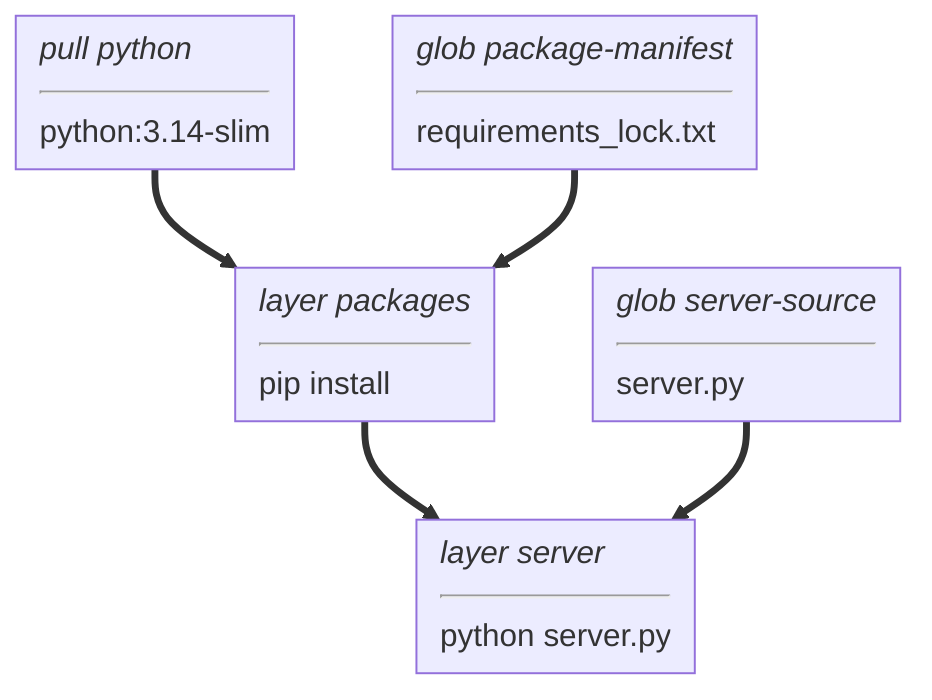

# fastmcp example

An [MCP](https://modelcontextprotocol.io) server with one tool, `echo`, built with [FastMCP](https://gofastmcp.com).
It speaks MCP over stdio.

## Build graph



## Develop

```
uv venv .venv
uv pip sync --python .venv requirements-dev_lock.txt
. .venv/bin/activate
ruff check . && ruff format --check . && pyright && pytest
```

## Dependencies

`requirements.txt` lists what the server needs and `requirements-dev.txt` adds the tools.
After changing either, regenerate both locks, with `--exclude-newer` set to two weeks ago:

```
uv pip compile --python-platform linux --python-version 3.14 --generate-hashes --exclude-newer YYYY-MM-DD \
  requirements.txt -o requirements_lock.txt
uv pip compile --python-platform linux --python-version 3.14 --generate-hashes --exclude-newer YYYY-MM-DD \
  requirements-dev.txt -o requirements-dev_lock.txt
```

## Build and run

The image installs only `requirements_lock.txt`.
From the repository root:

```
./vamos load server vamos-fastmcp -C examples/fastmcp
(cat examples/typescript-mcp/echo-request.jsonl; sleep 2) | docker run -i --rm vamos-fastmcp
```

When stdin closes, the MCP Python SDK cancels requests still in progress
and answers them with `Connection closed`, as MCP's stdio shutdown allows.
So keep stdin open until the reply arrives: the `sleep` above does that, where `< echo-request.jsonl` would not.
