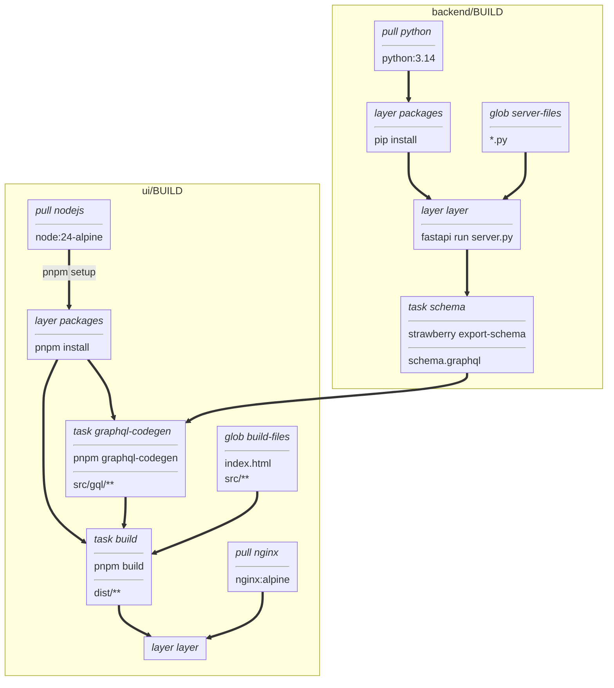

# strawberry-react example

A counter web app in two parts:

- `backend/`: a GraphQL API built with [Strawberry](https://strawberry.rocks)
  on [FastAPI](https://fastapi.tiangolo.com).
  It serves `/graphql`.
- `ui/`: a [React](https://react.dev) page built with [Vite](https://vite.dev)
  that reads and increments the counter with [Apollo Client](https://www.apollographql.com/docs/react).

The UI's TypeScript types come from the backend's schema.
The backend exports `schema.graphql` into `ui/`,
and [GraphQL Code Generator](https://the-guild.dev/graphql/codegen)
turns it and the queries in `src/queries.ts` into `src/gql/types.ts`.
Both files are generated, so neither is committed.

## Build graph

The main build paths connect the backend image and its schema to the UI bundle and nginx image.



## Develop

Backend:

```
cd backend
uv venv --python 3.14 .venv
uv pip sync --python .venv requirements_dev_lock.txt
. .venv/bin/activate
pyright && pytest
fastapi dev server.py --port 8100
```

UI, once the backend's virtual environment exists:

```
cd ui
pnpm install
(cd ../backend && .venv/bin/strawberry export-schema schema -o ../ui/schema.graphql)
pnpm codegen
pnpm check           # eslint and tsc
pnpm dev             # http://localhost:3100, proxying /graphql to the backend on port 8100
```

## Build with vamos

The directory is a vamos workspace: `backend/` and `ui/` each have a `BUILD` file,
and both load helpers from `defs.star`.
The UI's `graphql-codegen` task adds `//backend:schema`, the backend's exported schema,
so no generated file is needed on disk.
From the repository root:

```
./vamos load //backend:layer strawberry-backend -C examples/strawberry-react
./vamos load //ui:layer strawberry-ui -C examples/strawberry-react
./vamos build //backend:lint //backend:test //ui:lint -C examples/strawberry-react
```

Each package's `server` is an index of its `layer` for amd64 and arm64, which `push` sends whole:

```
./vamos push //ui:server ghcr.io/me/strawberry-ui:1.0 -C examples/strawberry-react
```

The backend's layer installs Python packages, which may have native code,
so each platform's runs on that platform, under emulation for the other.
The schema, codegen and the UI's bundle are the same on every platform,
so those tasks run once, natively, on a base for the exec platform (`dep(..., platform = EXEC_PLATFORM)`).

The UI's `build` task takes two parameters, which its `layer` and `server` pass on.
`mode` builds it with Vite's `development` mode when `debug`,
and `languages` chooses which of `ui/public/locales` go into the bundle (the page doesn't read them yet).
The backend takes none, so they don't reach it:

```
./vamos load //ui:layer strawberry-ui:debug --set mode=debug --set languages=en,es -C examples/strawberry-react
```

The checks are tasks without output: building them runs pyright, pytest and eslint.

## Run

The UI's image only serves its static files, and sends GraphQL requests to its own origin's `/graphql`.
In production an HTTP load balancer or an ingress would route that path to the backend.
`docker-compose.yaml` stands in for one with an nginx `ingress` service, which serves both on port 8080.
Once both images are loaded:

```
docker compose -f examples/strawberry-react/docker-compose.yaml up
```

Then open http://localhost:8080.

## Dependencies

`backend/requirements.txt` lists what the server needs and `requirements_dev.txt` adds the tools.
After changing either, regenerate both locks, with `--exclude-newer` set to two weeks ago:

```
uv pip compile --python-platform linux --python-version 3.14 --generate-hashes --exclude-newer YYYY-MM-DD \
  requirements.txt -o requirements_lock.txt
uv pip compile --python-platform linux --python-version 3.14 --generate-hashes --exclude-newer YYYY-MM-DD \
  requirements_dev.txt -o requirements_dev_lock.txt
```

`ui/pnpm-workspace.yaml` only lets pnpm install releases at least two weeks old, and saves exact versions.
