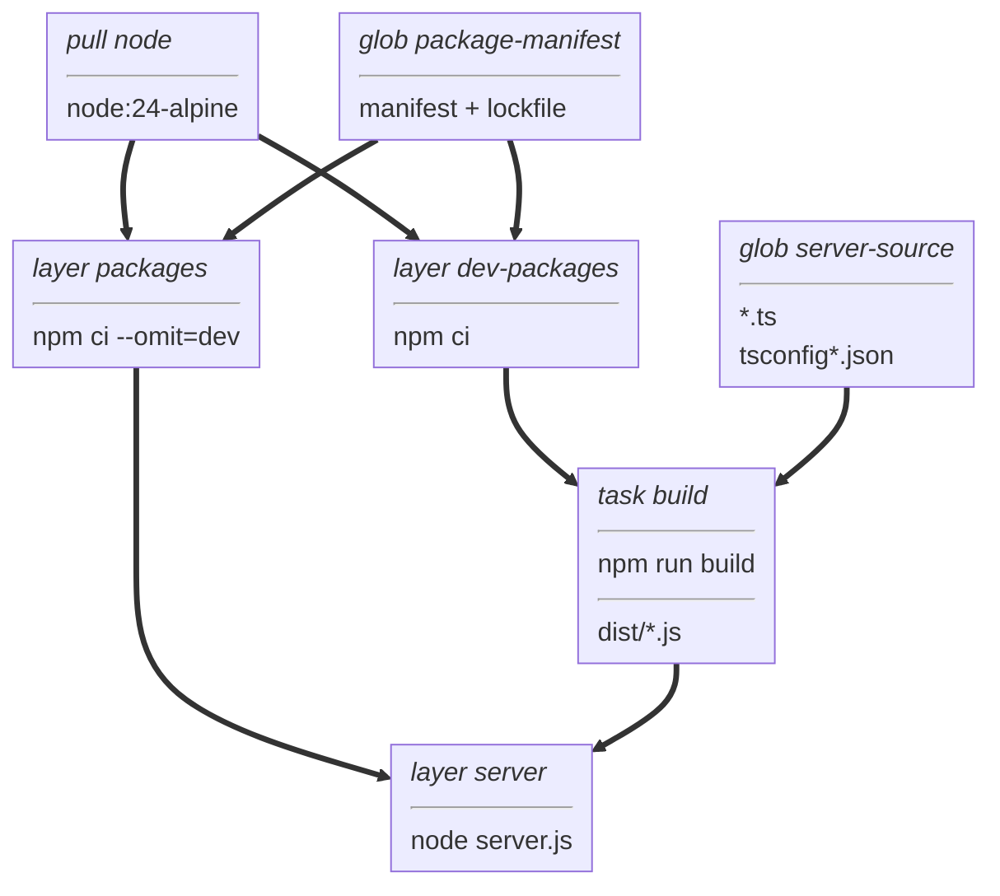

# typescript-mcp example

An [MCP](https://modelcontextprotocol.io) server with one tool, `echo`,
built with the official [TypeScript SDK](https://github.com/modelcontextprotocol/typescript-sdk).
It speaks MCP over stdio.
In development, Node runs `server.ts` directly by stripping its types.
The image runs `server.js`, which a `task` in `BUILD` compiles with `npm run build` (`tsconfig.build.json`);
only the compiled file and the runtime dependencies reach the image.

## Build graph



## Develop

Needs Node.js 24.2 or later, for `import.meta.main`.

```
npm ci
npm run check        # eslint, tsc, and node --test
```

## Dependencies

`.npmrc` only lets npm install releases at least two weeks old, and saves exact versions.
To get a security fix sooner, add `--min-release-age=0` to `npm install`.

## Build and run

The image installs only the runtime dependencies.
From the repository root:

```
./vamos load server vamos-example -C examples/typescript-mcp
docker run -i --rm vamos-example < examples/typescript-mcp/echo-request.jsonl
```
