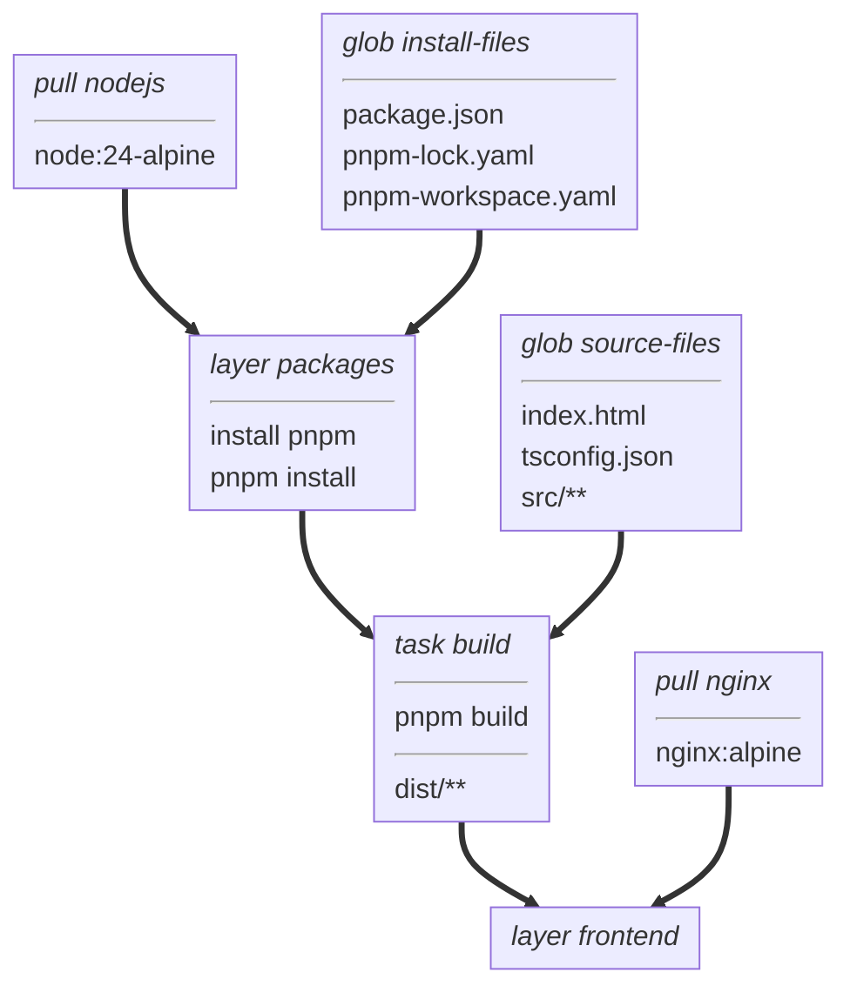

# typescript-ui example

A small TypeScript website built with Vite and served by nginx.
This is the project used by the [introductory tutorial](../../docs/tutorial.md),
which explains its `BUILD` file and how images and filesets compose.

## Build graph



## Build and run

Set up vamos using the [tutorial](../../docs/tutorial.md#2-set-up-vamos).
From the repository root:

```sh
vamos load frontend vamos-hello:dev -C examples/typescript-ui
docker run --rm -d --name vamos-hello -p 8080:80 vamos-hello:dev
```

Open <http://localhost:8080> on the Docker host.
Expect “Hello from vamos!” and “Built with Node.js, served by nginx.”
Stop the container with `docker stop vamos-hello`.

To export the built website without assembling an nginx image:

```sh
vamos export build examples/typescript-ui/out -C examples/typescript-ui
```

Use `--replace` to export again into that nonempty output directory.

## Develop

For local development, use Node.js 20.19 or later in the 20.x series, or 22.12 or later,
and pnpm 10.33.0.
From this directory:

```sh
pnpm install --frozen-lockfile
pnpm check
pnpm build
```

The build type-checks `src/main.ts` and bundles it into `dist/` with Vite.
`pnpm-workspace.yaml` requires dependency releases to be at least two weeks old and saves exact versions.
The committed lockfile supplies the same dependency selection to local and vamos builds.

## Sanity check

From the repository root, with the CLI built as `./vamos` and Docker available:

```sh
./examples/typescript-ui/check.sh
```

Set `VAMOS` to use a different CLI binary.
The script builds and loads `frontend`, exports `build`, and starts nginx.
It fetches the page and its JavaScript bundle over HTTP and compares both with the exported files.
It removes its temporary container, image tag, and output directory on exit.
